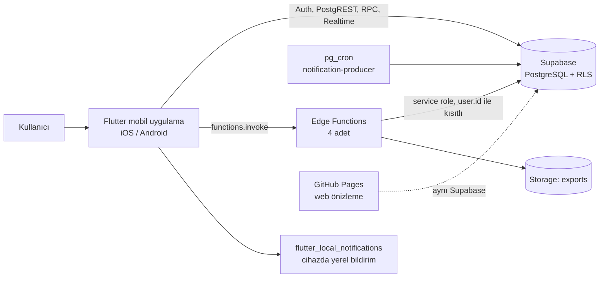
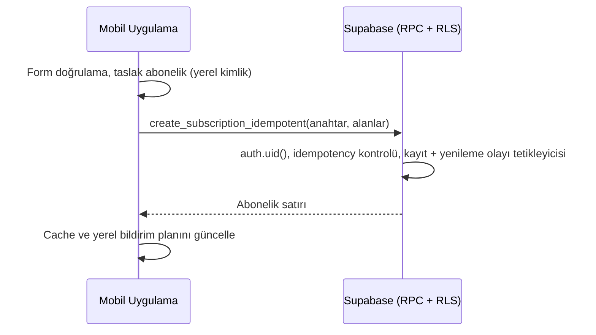
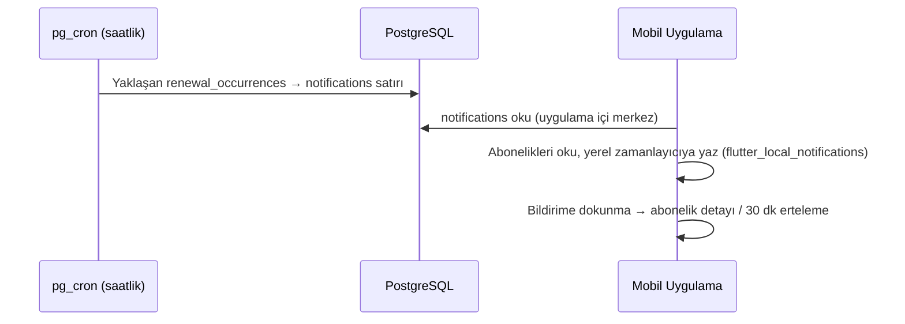

# Sistem Mimarisi

**Durum: Uygulandı** (aksi belirtilmedikçe). Mobil kod yapısı için [MOBILE.md](MOBILE.md), şema için [DATA_MODEL.md](../reference/DATA_MODEL.md), sözleşme için [API.md](../reference/API.md), canlı ortam için [SUPABASE_LIVE_STATUS.md](../reference/SUPABASE_LIVE_STATUS.md).

## 1. Amaç ve ilkeler

SubscriptTrack, iOS ve Android için bir abonelik takip uygulamasıdır. Web yalnızca tanıtım/yardım/yasal içerik ve geliştirme önizlemesi içindir; abonelik yönetimi web'de yapılmaz.

- **Supabase-only:** Tek backend Supabase'dir (Auth, PostgreSQL + RLS, PostgREST, RPC, Realtime, Edge Functions). Firebase ve başka servisler kullanılmaz ([ADR 0009](../decisions/0009-supabase-only-architecture.md)).
- **Güvenli varsayılan:** Sahiplik kararı veritabanında (RLS) ve sunucuda verilir; istemci tek uygulayıcı değildir.
- **Idempotent yazma:** Kritik yazmalar idempotent RPC'lerle yapılır; tekrar çalıştırma çift kayıt üretmez.
- **Domain-first, katmanlı istemci:** İş kuralları saf Dart domain katmanında; katman kuralları testle korunur ([MOBILE.md](MOBILE.md)).
- **Offline dayanıklılık:** Son veri cihazda tutulur; başarısız yazmalar kuyruğa alınır.
- **Para ve zaman:** Para `Money` (minor unit), zaman UTC + kullanıcının IANA zaman dilimi ([ADR 0004](../decisions/0004-money-as-decimal.md), [ADR 0005](../decisions/0005-utc-and-user-timezone.md)).

## 2. Sistem bağlamı

Bileşenler:

| Bileşen | Sorumluluk | Durum |
|---|---|---|
| Mobil uygulama | Arayüz, domain kuralları, cache, offline kuyruk, yerel bildirim planlama | Uygulandı |
| Supabase Auth | Kayıt, giriş, doğrulama, şifre sıfırlama, oturum | Uygulandı (yalnızca e-posta; sosyal giriş kapalı) |
| PostgreSQL + RLS | Ana veri; kullanıcı izolasyonu | Uygulandı |
| RPC fonksiyonları | Idempotent abonelik/ödeme/export yazmaları | Uygulandı |
| Edge Functions | Hesap silme, dışa aktarma, ödeme yöntemi etiketleri, destek/katalog | Uygulandı |
| Realtime | Çoklu cihaz `subscriptions` senkronu | Kısmi (kod ve yayın var; iki oturumlu canlı doğrulama yok) |
| pg_cron | Saatlik uygulama içi bildirim üretimi | Uygulandı |
| GitHub Pages | Flutter web önizleme (ürün dashboard'u değil) | Uygulandı |
| Uzak push, e-posta worker, ayrı API sunucusu | — | Kapsam dışı |

## 3. Veri akışları

### Abonelik ekleme

Bağlantı yoksa istek `OfflineMutationQueue`'ya alınır ve bağlantı gelince sırayla tekrar denenir (FIFO).

### Bildirim

Cihaz üzerindeki yerel bildirim birincil hatırlatma kanalıdır; ayrıntı [NOTIFICATIONS.md](NOTIFICATIONS.md).

## 4. Cache ve offline

- Son başarılı liste ve veriler cihazda saklanır; ağ yokken okunabilir.
- Başarısız yazmalar kalıcı kuyruğa alınır; bağlantı gelince FIFO tekrar denenir.
- Supabase yapılandırması yoksa uygulama **yerel modda** çalışır (auth ve abonelikler cihazda). Bu mod geliştirme/demo içindir.

## 5. Güvenlik özeti

RLS tüm tablolarda açıktır; Edge Function'lar JWT doğrular; service-role anahtarı yalnızca sunucuda tutulur. Ayrıntı ve açık bulgular: [SECURITY.md](SECURITY.md).

## 6. Ortamlar

| Ortam | Durum |
|---|---|
| Yerel mod (Supabase yok) | Uygulandı |
| Supabase (tek proje, `tdbljrojcmyjwchawfif`) | Uygulandı |
| Ayrı staging Supabase projesi | **Yok** (Planlı) |
| GitHub Pages web önizleme | Uygulandı |

Tek proje kullanıldığı için geliştirme ve canlı veri ayrımı yoktur; ayrı staging projesi yayın öncesi kararı bekler ([RELEASE.md](../operations/RELEASE.md)).

## 7. Gözlemlenebilirlik

Uygulama için crash raporlama, merkezi log ve metrik altyapısı **yoktur** (Planlı; ürün analitiği için [ANALYTICS.md](../product/ANALYTICS.md)). Edge Function logları Supabase panelindedir.

## 8. Açık noktalar

| Konu | Durum |
|---|---|
| Migration zinciri ile canlı şema sapması | Açık ([SUPABASE_LIVE_STATUS.md](../reference/SUPABASE_LIVE_STATUS.md)) |
| Edge Function hız sınırı | Kısmi: repoda hazır (migration 032), canlıda uygulanmadı |
| Staging ortamı, crash raporlama | Planlı |
| Realtime iki oturumlu doğrulama | Açık |
